# The software factory guide

This guide is for developers who have never seen Theseus, or the method it runs. It explains three things, in
order:

1. **The software factory in general**: what an agentic factory is, what Objective-Driven Agentic Development means, and
   why the method has gates, independent checks and holdout scenarios.
2. **The method, exactly**: the pipelines, their stages, records and gates, the project file, rounds, the evidence
   block, the spec gate, holdouts and locks.
3. **The factory in Theseus**: the board, cards, projects, links, proposals, the tools a session gets, verifiers,
   headless runs, budgets, breakers, duties and the overnight queue.

Parts 1 and 2 hold on any operating system. To run the method in plain Claude Code on Windows, macOS or Linux, without
Theseus, install the `agentic-factory` plugin: [Getting started with the agentic factory](getting-started.md) shows
how. Part 3 is what Theseus adds on Windows.

Method version described: `method-v0.2`, with the unattended ladder added for `method-v0.3`.

The method is versioned like code. Its version is a line in each project file (`**Kit:** method-v0.2`), so a change to
the method never reaches a running project unannounced. This guide describes the method as it is on `main` in the
Theseus repository: `method-v0.2`, plus the section "Working unattended: decide, record, or park", which is in the
method files for `method-v0.3` and is not yet released as a tag.

Where this guide describes something that is proposed rather than built, it says so with a mark:
<span class="status proposed">Proposed</span>. Everything without that mark is in the method files or in Theseus's
code.

## How to read the diagrams

Every concept and flow has a diagram. They use one visual language throughout:

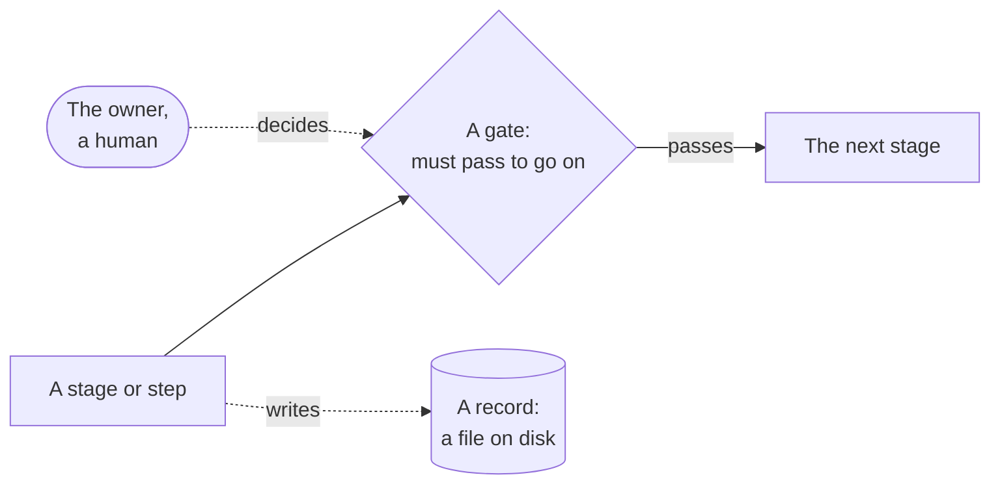

Figure 1. Boxes are stages, diamonds are gates, cylinders are records written to disk, and rounded boxes are people.
Dotted lines are "writes" or "decides"; solid lines are the order of work.

## Words used throughout

A short list here; the full glossary is at the end.

| Word | Meaning |
|---|---|
| **Session** | One running Claude Code conversation, in a terminal tab or headless |
| **Workstream**, or **card** | A piece of ongoing work on the Theseus board, with its own session, prompt and handover notes |
| **The owner** | The human the factory works for: in your projects, you |
| **Project** | A folder with a `project.md` that sets an objective, phases and derived objectives |
| **Pipeline** | The ordered stages a piece of work goes through: `freeform`, `feature` or `bug` |
| **Gate** | What has to be true before work moves past a stage |
| **Evidence** | Measured results: builds, test counts, warnings, scenarios run |
| **Holdout scenario** | A check the builder never sees, run by an independent verifier |

# Part 1: The software factory

## What an agentic factory is

An agentic factory is a way of building software in which AI agents do most of the work of each stage (research,
specification, planning, building, verifying, reviewing) and humans set direction and make the decisions that matter.
It is called a factory because the work goes through the same stations every time, and each station leaves a record
that the next station, and any person, can read.

It is not "ask a chatbot to write some code". The difference is structure:

- **Work is broken into stages with records.** Each stage writes a file, so nothing important lives only in a
  conversation that will be lost.
- **Stages have gates.** A stage does not pass because an agent says it is done. It passes on evidence, or on the
  owner's decision.
- **Agents do not judge their own work.** A different session checks the work, using scenarios the builder never saw.
- **Many sessions run at once**, on one machine, sharing resources through locks, and handing work to each other
  through links.

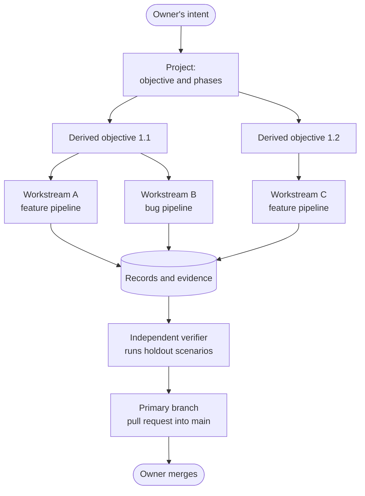

Figure 2. The factory from intent to merge. The owner sets the objective at the top and merges at the bottom. In
between, sessions do the work, write records and check each other.

## Objective-Driven Agentic Development

**Objective-Driven Agentic Development** is the name of the methodology. **The agentic factory** is the approach as a
whole, and planning inside it is **objective-driven**. (The names are new and may still
change.)

Objective-driven means work is planned from outcomes, not from a list of tasks:

- A **project** has one **objective**: the outcome the whole project exists for, with acceptance criteria that are
  observable facts ("evidence, not dates").
- The project is broken into **phases**. Each phase has **derived objectives**, each with its own acceptance criteria,
  and one **exit gate** that says who decides the phase is done, and on what evidence.
- **Workstreams** serve exactly one derived objective each. Several may serve the same one at once.
- An objective is **done** when every one of its criteria is ticked. A criterion is ticked on evidence, with a pointer to
  what shows it is met.

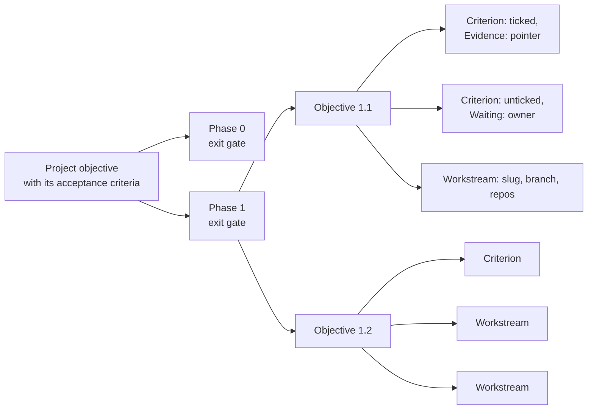

Figure 3. The objective tree. The project's current phase is the first phase with an objective that is not done.

Why objectives rather than tasks? Because the factory's agents make many small decisions on their own. A task list says
what to do but not why, so an agent that meets something unexpected has nothing to decide against. An objective with
acceptance criteria tells it what success looks like, and lets anyone (an agent, a verifier, the owner) check the
result against the same words.

## Levels of autonomy

Autonomy is how much of a stage runs without a person. The method names four levels. Autonomy is set **per repository**,
and a workstream runs at the lowest level allowed by any repository it changes.

| Level | Name | What it means |
|---|---|---|
| L0 | Assist | A person starts and accepts every stage. Every gate is a question |
| L1 | Prepared | Named in the method; its definition is not yet written |
| L2 | Unattended to PR | Work runs from research to review without asking, stopping only for the owner's gates |
| L3 | Gated merge | The merge happens when every gate passes. Not proposed yet |

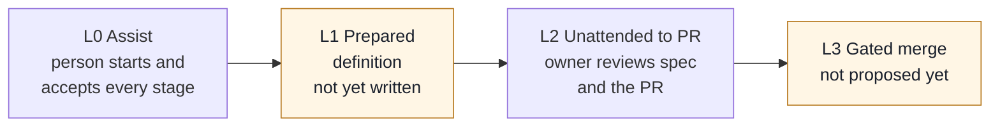

Figure 4. The autonomy ladder. Amber levels are named in the method but not yet defined.

The definitions of L1 and L2 are a written proposal, not yet in the method <span class="status proposed">Proposed</span>.
What is decided, and already in the method and in Theseus, is the practical core of L2 inside a project: the owner's
gates are each workstream's **spec** (a bug's **rule**) and the primary branch's **pull request into main**. Research,
plan, build, verify, review and starting the next workstream run without the owner.

## Why the method has gates

An agent that has worked hard on something is the worst judge of whether it is finished. It also cannot tell the
difference between "I believe this is done" and "this is shown to be done". Gates make that difference explicit.

There are three kinds of gate in the pipelines:

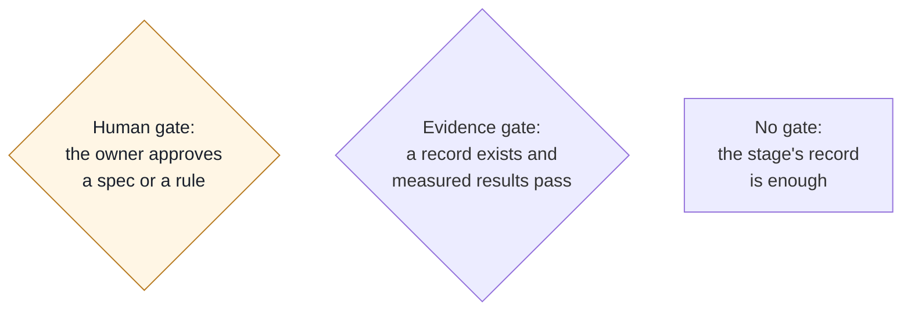

Figure 5. Gate kinds. A human gate is passed only by the owner. An evidence gate is passed by what was measured,
never by what a session says.

Two rules make the gates honest:

- **A claim is not proof.** A session can write anything in a file, so a field it writes is information, never proof
  that a gate passed. The owner's acceptance of a spec is recorded by Theseus on the board, not in a file a session can
  write.
- **Never invent a figure.** Where a number is not known, the record says `[not recorded]` or a bracketed placeholder.
  Stage times are taken from log lines and commits, never estimated, because agents asked to record times wrote
  estimates twice in the first trial.

## Why independent checks

**The implementer never judges its own work alone.** Verification and review are done by a different session or
person. This is not because agents are careless. It is because whoever wrote the code also wrote the tests, and both
share the same blind spots: a test written by the implementer tends to assert what the implementer believed, including
what it got wrong.

The method learned this the hard way. Twice in one day, in the first trial, a test asserted the implementer's own wrong
words. Hence the rule: **text a user acts on is checked against its source** (the spec or the vendor's documentation),
not against the code that prints it.

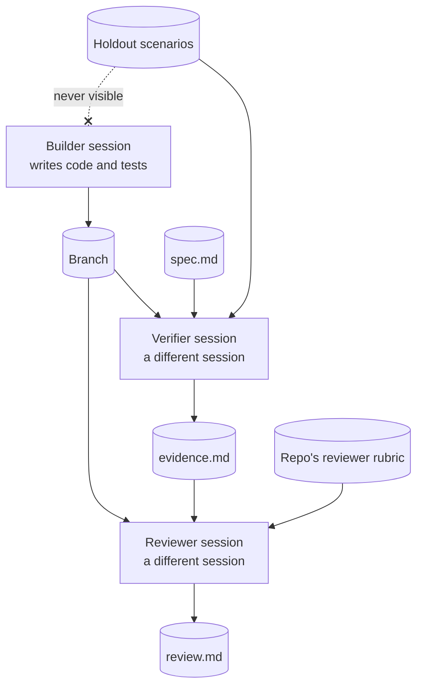

Figure 6. Independence. The verifier and the reviewer are different sessions from the builder, and the holdout
scenarios never reach the builder.

## Why holdout scenarios

A **holdout scenario** is an end-to-end check that the sessions doing the work never see or change. The name comes
from machine learning, where a holdout set is data kept back from training so it can test the result honestly.

If the builder could read the scenarios, it would build to pass them, and passing them would prove nothing more than
its own tests do. So:

- Scenarios live in a **separate private repository**, outside the project's code.
- A spec names the scenarios that apply **by name only**.
- Only a **verifier** reads and runs them, and it reports back **only a verdict**: each scenario's name, pass or fail,
  and one line. The details stay in the holdout repository.
- A **named holdout scenario is run, or verify stays open** (lesson P18). If nobody can run it, the stage does not
  pass, so the gap shows instead of being passed over. In the first trial every spec named scenarios and none was run;
  this rule exists so that cannot happen again.

How Theseus keeps scenarios hidden from builders is described in Part 3, under the holdout guard.

## What a human keeps, and why

The factory runs a great deal without the owner, but some decisions are never delegated. Each is kept because getting
it wrong is expensive, hard to undo, or affects people outside the project.

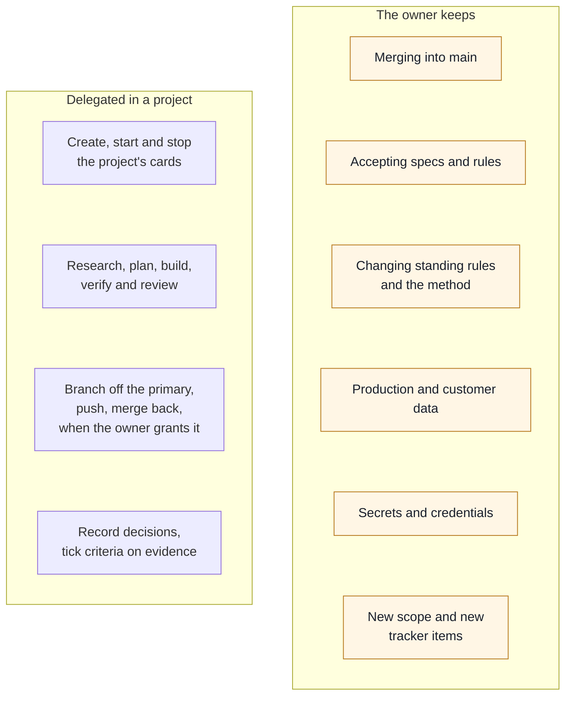

Figure 7. The boundary: what is delegated inside a project (left), and what always stays with a person (amber).

| Kept by the owner | Why |
|---|---|
| **Merging into main** | Main is what everyone else builds on and what ships. One pull request takes a project's primary branch into main, and only the owner completes it |
| **Specs and rules** | The spec says what "right" means. If an agent could accept its own spec, every later gate would measure against the agent's opinion |
| **Standing rules and the method** | Rules are what every session is held to. Lessons from a project are offered as proposals; the owner decides which become the next method version |
| **Production and customer data** | Mistakes there reach customers. Changes reach production through deployment pipelines, never from a developer's machine |
| **Secrets** | A leaked credential cannot be un-leaked. Agents never generate, copy or store secrets without approval |
| **Scope and backlog** | Extra items are noise, and scope is the owner's call. Agents propose; they do not raise items unasked |
| **Deletes** | Branches, worktrees, files and records. A delete cannot be undone before merge, so it is never a session's default |

## Rules that hold everywhere

The method has a short list of rules that apply to every pipeline. Each came from a real failure, and the lesson
number in brackets is where it was learned.

| Rule | Why it exists |
|---|---|
| Plain files, in the repo | Pipelines, projects and records are text, reviewed and versioned like code |
| Nothing assumes one repo | A workstream may change several repos on one branch name, with a worktree per repo |
| Never invent a figure | Write a bracketed placeholder and list it |
| Stage times are measured, never estimated (P1) | Agents asked to record times wrote estimates twice |
| A sub-agent's brief carries the rules it needs (P2) | A sub-agent does not inherit its parent's rules: no deletes, the files it may write, no tracker writes, no commits or pushes, the holdout off-limits |
| Stop patching when the edges keep coming (P10) | A third fix pass in the same place is the signal to write a spec instead |
| New tests go in a new file (P9) | So "the reproduction test is unchanged since it failed" stays a plain diff check |
| Text a user acts on is checked against its source (P17) | Tests asserted the implementer's own wrong words |
| A named holdout scenario is run, or verify stays open (P18) | Every spec named scenarios and none was run |
| An existing test changes only to correct a wrong expectation (P12) | The verifier judges whether a change is a correction or a weakening |
| No machine paths or card ids in public records (P19) | A test in the suite fails any change that adds them |
| A child exits once its report is in | Its parent restarts it with an instruction when there is more work |

# Part 2: The method, exactly

## The kit

The method is a small, versioned set of plain files in the Theseus repository, under `method/`. Theseus was built with
it, and runs it for other projects.

| File | What it defines |
|---|---|
| `method/README.md` | The rules that hold everywhere, the two modes, the autonomy levels, decisions and open questions |
| `method/project.md` | The project file format, the owner's gates in a project, rounds, and the evidence block |
| `method/pipelines/freeform.yaml` | Ad hoc work: one stage, no gates |
| `method/pipelines/feature.yaml` | research, spec, plan, implement, verify, review, compound |
| `method/pipelines/bug.yaml` | reproduce, rule (only when needed), fix, verify, then review and compound when the rule ran |
| `method/starter/project.md` | The file a new project begins with |

Each repository keeps its own **reviewer rubric**, drawn from that codebase's dated decisions and named in its
`AGENTS.md`. The kit has none, because a rubric belongs to a codebase, not to the method.

Versions are git tags, `method-v<major>.<minor>`, separate from app releases. `method-v0.1` was the kit at the end of
the first trial on 19 November 2026, after six hand-run changes and 17 lessons. `method-v0.2` (20 November 2026) added
the evidence block, rule P18, a tighter project file that Theseus can read, and the owner's gates inside a project. At
the time of writing only `method-v0.1` carries a tag; `method-v0.2` is the version project files name, and the
unattended ladder described below is being added for `method-v0.3`.

## Two modes

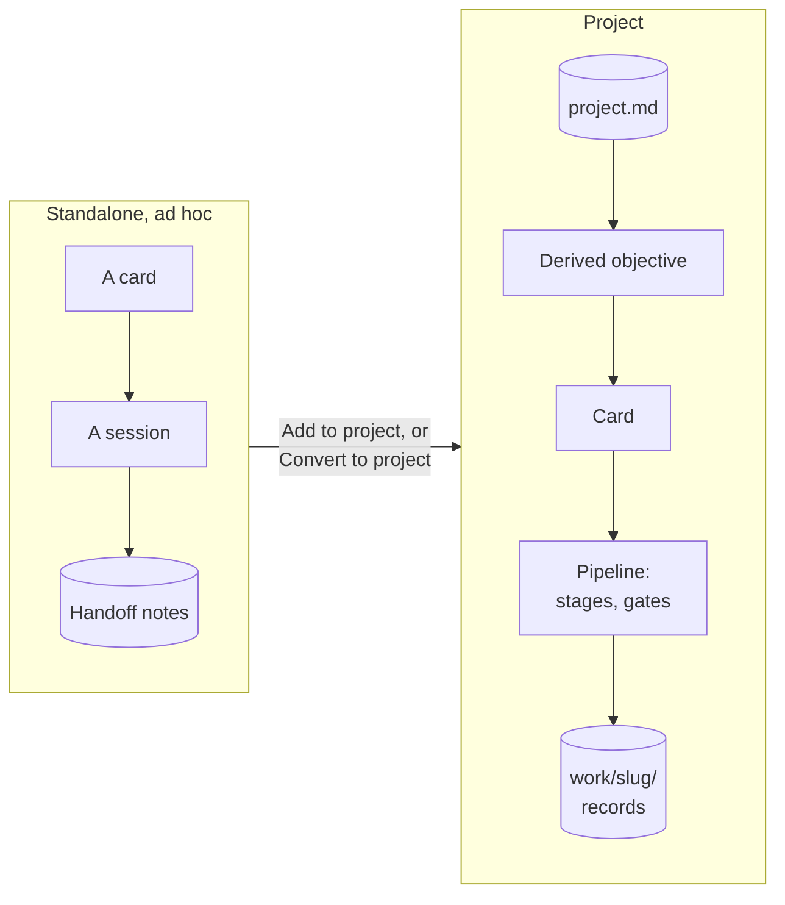

Figure 8. The two modes. Ad hoc work can be promoted into a project; its handoff becomes the project's first document.

- **Standalone (ad hoc).** A card, a session and a handoff. It runs `freeform`: no project file, no records folder, no
  gates, and not one more click than Theseus has always needed.
- **Project.** A project file sets an objective and phases. Each workstream serves one derived objective and runs a
  pipeline, with gates and evidence. Evidence is always shown when it exists; only project gates block on it.

## The anatomy of a stage

Every stage in a pipeline file has the same fields:

| Field | Meaning |
|---|---|
| `id` | The stage's name, such as `spec` |
| `role` | Who does it: researcher, specifier, planner, implementer, verifier, reviewer, compounder |
| `independent_of` | A role it must not share a session with. Verify and review are independent of the implementer |
| `when` | A condition for the stage to run at all |
| `inputs` | What it reads |
| `outputs` | The records and commits it writes, under `work/<slug>/` |
| `produces` | What the record must say, in prose |
| `gate` | `kind` (human, evidence or none), `who`, `passes_when`, and whether it `blocks` |
| `skip` | When the stage may be skipped. A stage with no `skip` may not be skipped |

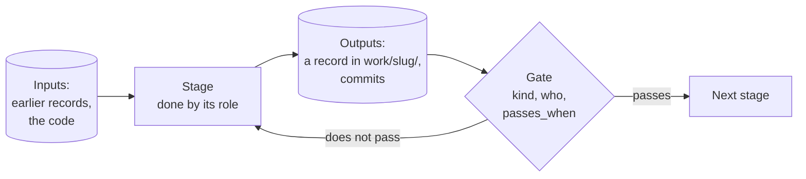

Figure 9. One stage. The record is written before the gate is judged, so the gate always has something to judge.

## The freeform pipeline

`freeform` is ad hoc work, exactly as Theseus has always run it. One stage, called `work`, with no gate. Its inputs are
the card's prompt, or its handoff when it has run before; its outputs are the work itself and the handoff, written when
the session is stopped. Tests the session ran and pull requests it opened are shown on the card when present, but never
block anything.

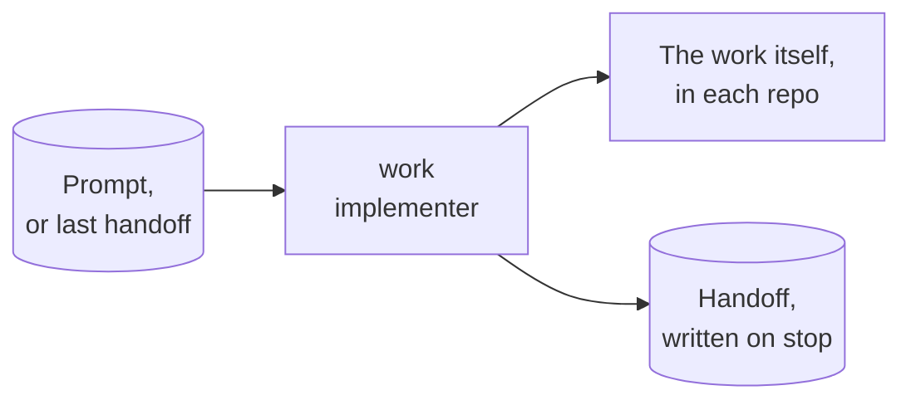

Figure 10. The freeform pipeline: one stage, no gates.

## The feature pipeline

A feature is a new capability, or a change in behaviour, inside a project. It has seven stages.

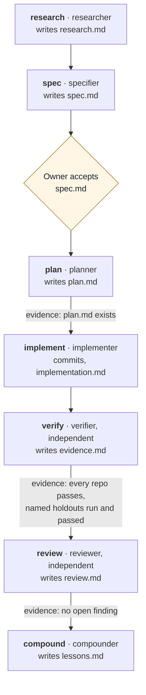

Figure 11. The feature pipeline. The amber diamond is the owner's gate; the labelled arrows are evidence gates.

| Stage | Record | Gate | May skip? |
|---|---|---|---|
| **research** | `research.md`: what exists, what the change touches in each repo, prior decisions, options and trade-offs; for an external system, its failure modes as well as its happy path. No code changes | none | Yes, when an accepted spec or another piece's research already covers it |
| **spec** | `spec.md`: what the change must do, from the user's side, as acceptance criteria a test or a scenario can decide; what is out of scope; which holdout scenarios apply, by name only | **human**: the owner accepts `spec.md` | Never |
| **plan** | `plan.md`: the steps, the files in each repo, the tests to write first, the risks, and how each step will be verified. When code moves out of an existing sequence, what that sequence guaranteed and how the new path keeps it | evidence: `plan.md` exists and implement has been reached (does not block) | No |
| **implement** | Commits on the branch in each repo, and `implementation.md`: what was done and **every** difference from the plan, however small | none | No |
| **verify** | `evidence.md`: one result per repo (build, tests, each holdout scenario) with its evidence. Run by someone other than the implementer | evidence: every repo passes, and every holdout scenario the spec names has been run by an independent verifier and passed | Never |
| **review** | `review.md`: findings against the spec and the repo's rubric, each citing what it breaks | evidence: no open finding (each fixed in code or accepted by the owner) | No |
| **compound** | `lessons.md`: what the method caught, what it missed, and what to change; proposed changes to `method/` as a separate commit | none: proposals only, the owner decides | No |

The verify stage carries most of the method's lessons. Steps a person is asked to carry out are checked against the
code before they are given. For a user interface, "unchanged" is checked against what is rendered, not against the
markup. And the verifier **removes each guard or condition the change adds, in a copy, and reports any test that still
passes** (P16): a test that passes without the code it is meant to test is testing nothing.

## The bug pipeline

A bug is behaviour that differs from what was decided or documented. Its pipeline is shorter, and two of its stages run
only when the fix needed a new rule.

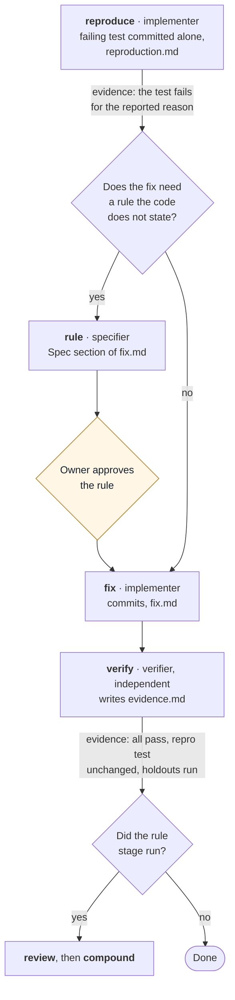

Figure 12. The bug pipeline. A rule means new behaviour, which is what review is for, so review and compound run only
when the rule stage ran.

| Stage | Record | Gate |
|---|---|---|
| **reproduce** | A test that fails for the reported reason, **committed on its own before any fix**; `reproduction.md` with the steps, expected and actual behaviour, the decision or document that says what is expected, and the failing output. If the defect is in code no test can reach, a refactor that changes no behaviour may come first, as its own commit with characterisation tests | evidence: the new test fails, for the reported reason, on the unfixed code |
| **rule** (only when needed) | The rule the fix will follow, in a few numbered lines, in the Spec section of `fix.md`, including what the code protects against and what it does when it cannot be sure | **human**: the owner approves the rule. This is the bug's spec |
| **fix** | The smallest change that makes the test pass without weakening it; `fix.md` says the cause, and why the change addresses the cause rather than the symptom | none |
| **verify** | `evidence.md`: one result per repo (build, the full test suite, the reproduction test passing unchanged, any holdout covering the behaviour) | evidence: as feature, plus the reproduction test unchanged since it failed |
| **review**, **compound** | As in the feature pipeline, when the rule stage ran | as feature |

Why commit the failing test first? Because "the test failed before the fix and passes after it, and was not changed in
between" is then a plain fact anyone can check from the history. Why a rule? In the first trial one bug took three fix
passes, each closing one class of input and opening another, until the rule was written down.

## Skipping a stage

A stage may be skipped only where its pipeline says so, in its `skip` field. A session says it skipped a stage with
`now_at(stage, "skipped: <reason>")`, or a line in `work/<slug>/skipped.md`. A feature's spec and the verify stage are
never skipped: only the owner's acceptance passes the first, and only the evidence and the independent check pass the
second. A stage before the furthest recorded one that is neither recorded nor skipped is shown as "done, no record".

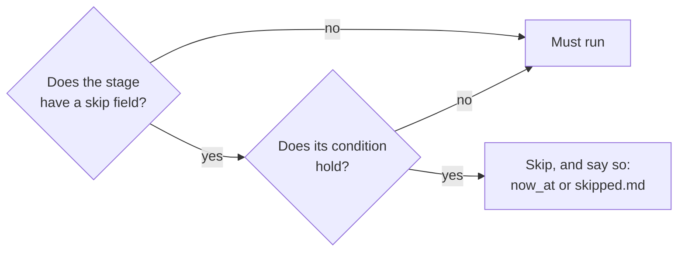

Figure 13. Deciding whether a stage may be skipped.

## The project file

A project is a folder, its **home folder**, holding `project.md` and `work/<slug>/`, the records of each workstream.
Home folders sit side by side in one **projects folder**, outside every code repository, so records never need a branch,
a merge or a pull request, and every session sees the same copy at once.

`project.md` is prose with a fixed shape: people read it, agents read it, and Theseus reads the lines that have a fixed
form. A file that does not follow the shape is shown as unreadable, with the line and the reason, never guessed at.

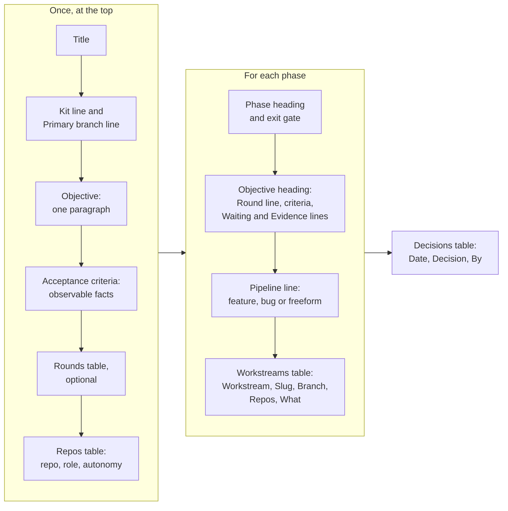

Figure 14. The shape of `project.md`: what comes once at the top, then each phase, then the decisions.

A short example:

```
# Checkout redesign

**Kit:** method-v0.2
**Primary branch:** dana/checkout-redesign

## Objective
Customers pay in one step on any device.

## Acceptance criteria
- [ ] Nine in ten test customers complete payment without help.

## Repos
| Repo | Role | Autonomy |
|---|---|---|
| github/acme/shop-api | home | L0 |
| github/acme/shop-web | changed by phase 1 | L0 |

## Phase 1: Payment
**Exit gate:** the owner accepts the evidence for each objective.

### Objective 1.1: One payment step
- [x] Card and wallet payments share one form.
      Evidence: work/payment-step/evidence.md, verify part 2
- [ ] Errors are shown beside the field that caused them.
      Waiting: owner: choose the wording for declined cards

**Pipeline:** feature
| Workstream | Slug | Branch | Repos | What |
|---|---|---|---|---|
| Payment step | payment-step | dana/payment-step | shop-api, shop-web | One form for every method |

## Decisions
| Date | Decision | By |
|---|---|---|
| 2026-11-20 | Wallets come before saved cards | Dana |
```

### The lines Theseus reads

| Line | Rule |
|---|---|
| `# <title>` | The first heading of the file |
| `**Kit:** <version>` | The method version the file follows. A file at `method-v0.1` is shown as pinned to it and not read further |
| `**Primary branch:** <branch>` | The project's long-lived branch, off the trunk. Workstream branches come off it and merge back; one pull request takes it into the trunk |
| `## Phase <n>: <name>` and `**Exit gate:**` | A phase, numbered from 0, and who decides it is done, on what evidence |
| `### Objective <n>.<m>: <title>` | A derived objective, numbered within its phase |
| `**Round:** <n>` | Optional: the round that added or reopened the objective |
| `- [ ]` and `- [x]` | Criteria, ticked when met |
| `Waiting: owner: …`, `Waiting: work: …`, `Waiting: on <who>: …` | Optional, under an unticked criterion: who it waits on, in plain words |
| `Evidence: <pointer>` | Optional, under a ticked criterion: what shows it is met |
| `**Pipeline:** <name>` | Once under every objective |
| The workstreams table | One row per workstream slug. The table alone puts a card in the project |

In the workstreams table, **Workstream** names the card as it appears on the board; **Slug** names both the records
folder, `work/<slug>/`, and the branch, `<user>/<slug>`; **Branch** is where its work is until merged into the primary;
**Repos** lists every repository it changes. A card named in several rows has worked under several slugs in turn; its
last row is its current one.

### Criteria, waits and evidence

A criterion moves through a small set of states, and each state is a line in the file, so the board can show it without
asking any session:

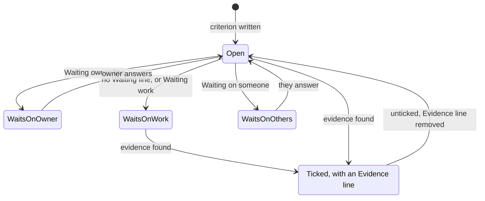

Figure 15. A criterion's life. A Waiting line on an owner puts it in the owner's "Waits for you" list on the board.

### Who writes which lines

**Theseus writes the structured lines; sessions write the prose.** Every line Theseus reads is written through its
tools, never by hand, so a session cannot leave the file unreadable. Each tool is refused, with its reason, when the
file changed since Theseus read it, or when the edit would not read.

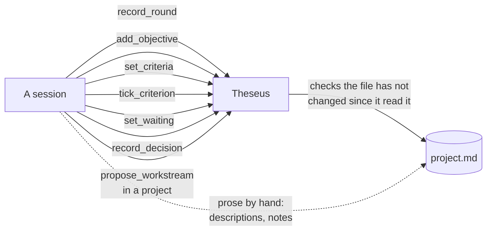

Figure 16. Structured lines go through Theseus's tools; prose is written by hand.

| Tool | Writes |
|---|---|
| `record_round(name, why, objectives)` | A row of the Rounds table and a Round line on each objective the round adds or reopens. Asks the owner first |
| `add_objective(phase, title, criteria, pipeline, waiting)` | An objective at the end of a phase, with its criteria, pipeline line and an empty workstreams table. Asks the owner first |
| `set_criteria(objective, criteria, waiting)` | Criteria in an existing objective, in place of its `[criteria to be written]` line or after those it has; existing lines are never changed. Asks the owner first |
| `tick_criterion(objective, criterion, text, ticked, evidence)` | A tick with its Evidence line; unticking removes the Evidence line |
| `set_waiting(objective, criterion, text, who, what)` | A criterion's Waiting line, or removes it |
| `record_decision(decision, by)` | A dated row of the Decisions table |

## Rounds

When the owner changes the requirements and work goes back to research, a new **round** begins. The session that
records the change calls `record_round` with the round's name, why the requirements changed in one sentence in the
owner's words, and the objectives it adds or reopens. The project view lists rounds in order, each after a banner
saying when, by whom and why the requirements changed. A file with no Rounds table reads as one round, "Round 1".

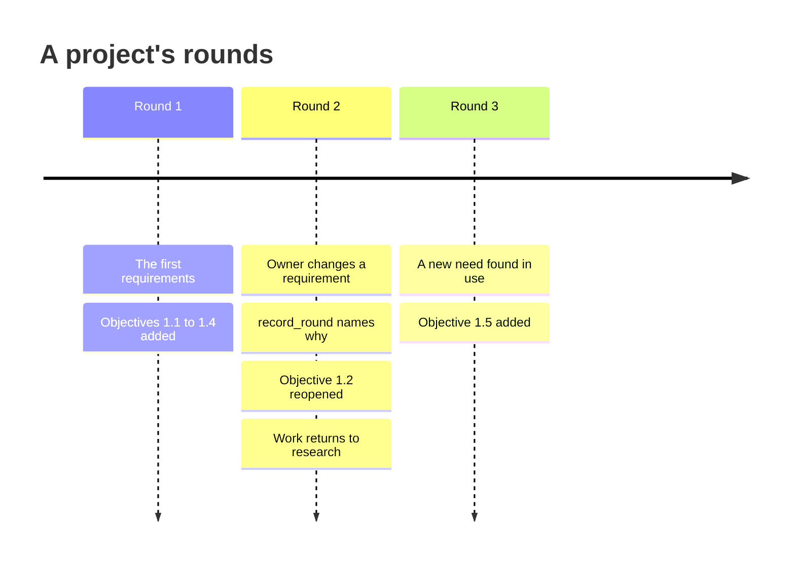

Figure 17. Rounds. Each round opens with the reason the requirements changed, so the history of "why" is kept.

Rounds exist so the record stays truthful. Without them, an objective that was finished and then reopened looks as if
it was never finished, and a reader cannot tell new scope from slipped work.

## The evidence block

The verify stage's result is written as a fenced block tagged `theseus-evidence` inside `work/<slug>/evidence.md`. It
holds JSON; the rest of the file stays prose. A file may hold several blocks (part 1 and part 2, or attempts); the
**last** one is the current one.

```
{
  "kit": "method-v0.2",
  "pipeline": "feature",
  "stage": "verify",
  "result": "open",
  "repos": [
    { "repo": "<repo>", "build": "pass",
      "tests": { "passed": "<n>", "total": "<n>" }, "warnings": "<n>" }
  ],
  "scenarios": [
    { "name": "<scenario>", "result": "not-run", "by": null }
  ],
  "gates": [ { "gate": "spec", "accepted": null } ]
}
```

| Field | Rule |
|---|---|
| `result` | `pass` only when every repo passes and every named scenario was run by an independent verifier and passed; otherwise `fail` or `open` |
| `repos[]` | One entry per repo changed: `build`, `tests` (passed and total, as numbers), `warnings` |
| `scenarios[]` | `pass`, `fail` or `not-run`, and `by`: who ran it |
| `gates` | **Information only.** A session can write it, so it is a claim, never proof |

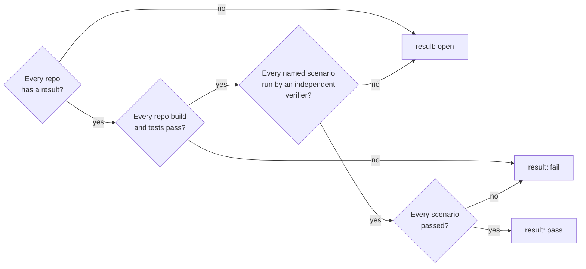

Figure 18. How the verify result is decided. A scenario nobody ran keeps it open, never passed.

## The spec gate

The spec gate is the owner's main lever in a project. **A session stops at its spec.** Once `spec.md` (a bug's rule) is
written, the session says so and waits. Before it plans, it calls `gates()`, which returns this workstream's gate, the
version of the spec on disk, and whether that version is accepted, when, by whom and how. It plans only when the
version on disk is accepted.

The owner saying "accept" in the session's terminal is not the gate. The session reports it with
`accept_spec(slug, version, owner_words)`, quoting the owner, and Theseus asks the owner to confirm on the board. Only then is it
recorded. A spec changed after it was accepted waits for the owner again, because acceptance is of a version, by its
content.

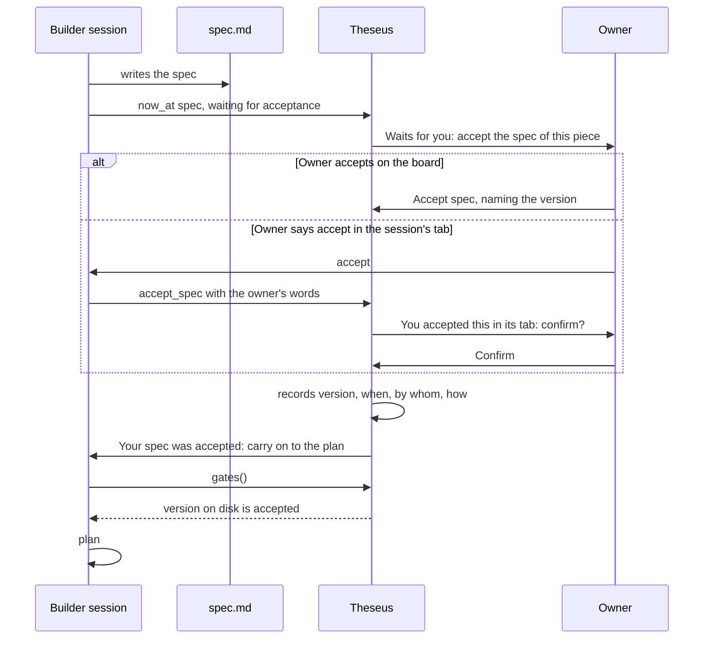

Figure 19. The spec gate. Whichever way the owner accepts, only the owner's action on the board records it, and the session
is told; a stopped card is started.

Why so careful? Because a file a session can write is a claim. If acceptance were a line in `spec.md`, a session could
write it. Recording it in Theseus, by the content of the version accepted, makes the owner's decision something no
session can forge or carry across to a changed spec.

## The independent check and holdouts

The verify stage must be run by someone other than the implementer. In a project, that someone is a **verifier card**:
a fresh session, started by Theseus rather than by the builder, that can read the holdout scenarios and writes only its
report.

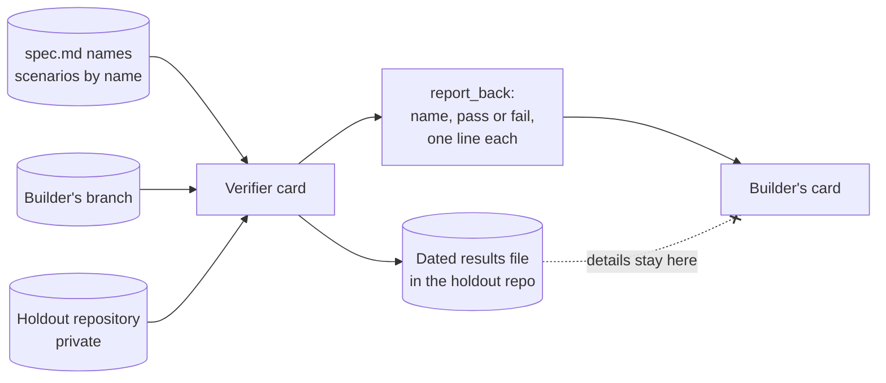

Figure 20. The independent check. Details stay in the holdout repository; the builder learns only the verdict.

Scenarios are tied to work by a line in each scenario, such as `Checks: payment-step`, naming the slugs it checks. A
verifier is made only for a build some scenario names, so one folder's scenarios never judge work they were not written
for. Scenarios are written by a **scenario writer** card, the one kind of session allowed to write in the holdout
folder, which writes scenarios and never code.

## Locks

Many sessions share one machine. Some jobs cannot safely run twice at once: two container-backed test suites starve
each other and fail in ways that look exactly like real defects. So the method coordinates shared resources with
**locks**, granted to one session at a time, in queue order.

| Lock | Protects |
|---|---|
| `tests` | Container-backed test suites and whole-solution builds |
| `dev-stack` | The shared local docker stack |
| `llama` | The local model server |

```mermaid
sequenceDiagram
  participant A as Session A
  participant L as Lock service
  participant B as Session B
  A->>L: request tests
  L-->>A: granted
  B->>L: request tests
  L-->>B: queued, place 1
  A->>A: runs the suite
  A->>L: released, on any exit
  L-->>B: granted
  B->>B: runs the suite
```

Figure 21. A lock and its queue. A session never asks a holder to give way and never stops another session's process.
Only the owner reorders a queue, cancels a request or releases a lock.

## Working unattended: decide, record, or park

This section was added to the method on 25 November 2026 for `method-v0.3`, from the lessons of a night of unattended
bug fixing. Overnight, 73 waits held sessions for about 68 hours of session time, and only 9 of them were truly the
owner's call. Most of the rest came from a session holding a question that a rule already answered, or that it could
have answered itself and recorded.

When a session meets a choice it would otherwise ask about, it goes down a ladder of three rungs:

```mermaid
flowchart TB
  Q["A choice the session<br/>would otherwise ask about"] --> C1{"Rung 1:<br/>is it owner-only?"}
  C1 -->|yes| P["<b>Rung 3: park</b><br/>write the question, options and<br/>recommendation; ask_owner;<br/>set_waiting; carry on with<br/>everything that does not depend on it"]
  C1 -->|no| C2{"Rung 2: does the recommended<br/>option keep every rule, undo<br/>before merge, change nothing<br/>accepted, rest on checked facts?"}
  C2 -->|no| P
  C2 -->|yes| D["<b>Rung 2: decide and record</b><br/>take it; record_decision as<br/>default, for review; list it in<br/>REPORT.md under Decided<br/>without the owner"]
  P --> E["When nothing is left: commit,<br/>handoff, report_back partial, stop.<br/>The owner's answer starts it again"]
  classDef human fill:#FFF6E5,stroke:#B7791F,color:#1A202C
  class P,E human
```

Figure 22. Decide, record, or park. Nothing that belongs to the owner is decided for the owner; a session never holds its
slot waiting for an answer.

**1. Owner-only: never decided by a session.**

- Completing, approving, abandoning or auto-completing a pull request into the trunk, and pushing or force-pushing to
  the trunk. A guard refuses these.
- Deleting anything: branches, worktrees, files, records.
- Creating a tracker item.
- Accepting a spec or a bug's rule, and confirming a report.
- Changing a standing rule.
- Production, secrets, customer data and every cloud mutation.
- A product decision the brief and the project's decisions leave open.

**2. Decide and record.** Anything else, the session decides. It takes the option it would recommend, provided all of
these hold: it keeps every standing rule; it can be undone before the change merges, because it lives on the
workstream's branch or in its own records; it changes no spec, rule or decision the owner has accepted; and the facts it
rests on are checked against the real system, not remembered. It records the choice with `record_decision`, by
`<card> (default, for review)`, and lists it in its report under **Decided without the owner**, with the option it
passed over. The owner can overturn it at review.

**3. Park.** When rung 1 applies, or rung 2's conditions do not hold, the session writes the question with its options
and its recommendation, calls `ask_owner`, and records who it waits on with `set_waiting`. Then it carries on with every
part of the work that does not depend on the answer. When nothing is left, it commits what it has, writes its handoff,
calls `report_back` with verdict `partial`, and stops.

A session never ends a turn on a question written in prose, because an ended turn looks finished on the board. Claude
Code's question tool holds the session until it is answered, so it is used only when the owner is at the desk.

The same section adds rules for unattended runs:

| Rule | Why |
|---|---|
| Check a fact before it becomes a decision or a brief: the tracker's real workflow states, tests whose expectations the fix reverses, how live code uses what a change blocks | A wrong fact written into a brief became the night's longest single wait, about 10 hours |
| Once the report is in, stop: write the handoff, call `report_back`, end the session | The owner confirms a report on the board without a live session. Finished sessions held their slots for about 12 hours |
| Commit a shared notes repository with care: stage only your own paths, never `git add -A`; on a lock file, retry with a growing delay up to five times; never delete a lock file | Concurrent commits and a stale lock blocked notes overnight |
| A wait is never a sleep: a locked run is one command line in its own call; anything long runs in the background, watched by a monitor | The lock guard reads only the line it is given |
| A failed turn is not the end of the work: after a network or API error, the next session to look, or Theseus, resumes it with "carry on where you were" | Seven sessions sat idle after a short network outage until someone typed "try again" |

## Lessons and the compound stage

The method improves from its own use. Every feature, and every bug that needed a rule, ends with a **compound** stage
that writes `lessons.md`: what the method caught, what it missed, and what to change in a pipeline, the rubric or
`AGENTS.md` so it is caught next time. These are proposals only. The owner accepts or rejects them, and accepted lessons
make the next method version.

```mermaid
flowchart LR
  W["A piece of work"] --> C["compound stage"]
  C --> L[("lessons.md:<br/>caught, missed,<br/>proposed change")]
  L --> O{"Owner accepts?"}
  O -->|yes| M["Next method version,<br/>a new tag"]
  O -->|no| X["Recorded, not applied"]
  M --> P["Projects move up<br/>when the owner chooses"]
```

Figure 23. How the method compounds. A project moves to a new method version deliberately, never by accident.

# Part 3: The factory in Theseus

## What Theseus is

Theseus is a Windows desktop application that runs many Claude Code sessions at once and shows them on one board. It
does not host terminals. It launches Claude Code into Windows Terminal tabs (or headless, with no tab) and tracks them
from the outside, so sessions you started by hand appear on the same board as the ones it started.

```mermaid
flowchart TB
  PF[("Projects folder:<br/>project.md and records")] <-->|"watched, read<br/>and written"| TH["<b>Theseus</b><br/>board, project view,<br/>duties, headless runner"]
  TH -->|"opens a Windows Terminal<br/>tab running the launcher"| LS["Launcher"]
  LS <-->|"named pipe:<br/>prompt, folder, title"| TH
  LS --> CC["Claude Code session"]
  TH -->|"or headless:<br/>print mode, stream-json"| CC
  CC <-->|"tools over MCP,<br/>one endpoint per session;<br/>locks"| TH
  CC -->|"end of every turn"| HK["Stop hook"]
  HK -->|"hands over a<br/>stop request"| CC
  CC -.->|"session registry entry"| TH
```

Figure 24. How Theseus connects to sessions. No prompt, path or title travels on a command line: the launcher collects
them over a named pipe.

A few design points matter for everything that follows:

- **Session identity is minted before the tab opens**, which is what makes a session resumable tomorrow rather than
  merely restartable.
- **Each session gets its own tool endpoint**, identified by the path it connects on rather than by anything it says,
  so a session cannot act as another workstream.
- **The project file is the source of truth.** Theseus watches the projects folder and reads a project again within a
  couple of seconds of a file changing.

## The board

The board is a grid. **Columns** are stages (New, Planning, In progress, Review, Done by default) or, in another view,
session states (Needs you, Working, Idle, Not running, Done). **Rows** are areas (Research and spikes, Dev, Support and
admin, Side projects), or folders, chains, or none. Cards are dragged only along what you place by hand.

**Paused** and **Blocked** are marks on a card, not columns, so a card keeps its stage while it waits. Paused is set aside
on purpose; Blocked is waiting on something outside your control.

```mermaid
flowchart LR
  subgraph C1["Needs you"]
    direction TB
    a["Card asking<br/>a question"]
  end
  subgraph C2["Working"]
    direction TB
    b["Card: busy"] ~~~ p["PROJECT card"]
  end
  subgraph C3["Idle"]
    direction TB
    c["Card: idle"]
  end
  subgraph C4["Not running"]
    direction TB
    d["Card: ended"] ~~~ e["Card with<br/>Paused mark"]
  end
  subgraph C5["Done"]
    direction TB
    f["Report back<br/>confirmed"]
  end
  C1 ~~~ C2 ~~~ C3 ~~~ C4 ~~~ C5
  classDef human fill:#FFF6E5,stroke:#B7791F,color:#1A202C
  class a human
```

Figure 25. The board viewed with columns by session state: the left column is everything waiting on you.

## A card's lifecycle

A card is one workstream. Its colour and wording follow its live session, not its plan file.

```mermaid
stateDiagram-v2
  [*] --> NotStarted: created
  NotStarted --> Starting: Start
  Starting --> Working: session opens
  Working --> Idle: turn ends
  Idle --> Working: new turn
  Working --> NeedsYou: asks a question
  NeedsYou --> Working: answered
  Idle --> Stopping: Stop requested
  Working --> Stopping: Stop requested
  Stopping --> Ended: handover written, exit
  Ended --> Starting: Start again, resumes
  Ended --> Done: report confirmed, or last stage
  Done --> Starting: Restart for more work
  Ended --> Archived: Archive
  Done --> Archived: Archive
  Archived --> Ended: Restore
```

Figure 26. A card's lifecycle. Paused and Blocked are marks that can sit on any state that has no session.

**Stopping never kills.** Stop writes a request; a hook in Claude Code, which runs at the end of every turn, hands the
request to the session instead of letting the turn end. The session writes its handover notes; once they appear and the
session has been quiet for 20 seconds, Theseus types `/exit` into its tab. A killed session writes nothing, and the next
session would start blind.

```mermaid
sequenceDiagram
  participant O as Owner
  participant T as Theseus
  participant H as Stop hook
  participant S as Session
  O->>T: Stop
  T->>T: writes a stop request
  alt Session is idle
    T->>S: types one word into its console, to start a turn
  end
  S->>H: turn ends
  H->>S: stop request delivered, once
  S->>S: writes handover notes
  T->>T: notes appear, 20 s quiet
  T->>S: types /exit
  S-->>T: tab closes
```

Figure 27. Stopping a session with its handover. Requests expire after four hours, so an evening request cannot
interrupt the next morning.

Some sessions end by themselves once idle for half a minute with no question of their own open: a verifier once it has
filed its report, a scenario writer once it has written its scenarios, and a card that reports back once its report is
accepted. A project's lead never ends by itself.

## Projects and the project view

Every project in the projects folder shows on the board as one **project card**, marked PROJECT, in the project's own
colour, with its current phase, how many objectives are done, one sentence saying where it is, and counts: done, busy,
waiting on you, waiting for their holdout check, stuck, still to do. The project's own cards leave the board while the
project card stands for them.

A project has a **lead card**, which starts first and plans objectives that have no workstream yet. A project starts and
stops as a whole: Stop remembers which cards had a session and asks each to hand over; Start starts exactly those again.

```mermaid
flowchart TB
  PC["Project card on the board"] -->|Open| PV["Project view"]
  PV --> SUM["Where it is: one sentence,<br/>six counts"]
  PV --> WFY["Waits for you band"]
  PV --> LENS{"Group by"}
  LENS --> RW["Rounds and work:<br/>pieces under their state"]
  LENS --> OO["Objectives only:<br/>phases, objectives,<br/>criteria counts"]
  RW --> BOX["A box per piece of work"]
  OO --> BOX
  BOX --> STG["Its stages, each<br/>with a mark"]
  BOX --> ACT["View spec, Accept spec,<br/>Independent check,<br/>Focus, Start, Stop,<br/>Open records"]
  PV --> PROP["Properties pane:<br/>state in words, records,<br/>links, criteria to tick"]
```

Figure 28. The project view. It shows where the project is without asking any session.

Each stage of a box carries a mark and a word, so nothing depends on colour alone:

| Mark | Word | Comes from |
|---|---|---|
| ✓ | Done | The stage's record, or a later stage recorded |
| ◆ | Waiting on you | A gate or a question that is the owner's |
| ● | Busy | The session's own `now_at` |
| ⚠ | Stuck | The records, or the card's Blocked mark; never the passing of time |
| ◐ | Holdouts not run yet | The evidence block |
| – | To do | Nothing recorded yet |

### Worktrees made at the start

When a project card starts, Theseus reads its row in `project.md`. If the row names a branch of its own, Theseus gets a
worktree ready for each repository in the row before the session opens: `<worktrees folder>/<slug>/<repo>`, on the
row's branch, made off the project's primary branch. Every repository is checked before anything is made, so a refused
start leaves nothing half made. **Theseus never clones, fetches or pushes.**

```mermaid
flowchart LR
  ROW["Row: slug payment-step,<br/>branch dana/payment-step,<br/>repos shop-api, shop-web"] --> F{"Clone found for<br/>every repo?"}
  F -->|no| R["Start refused,<br/>status bar says why"]
  F -->|yes| W1["work/payment-step/shop-api<br/>on dana/payment-step"]
  F -->|yes| W2["work/payment-step/shop-web<br/>on dana/payment-step"]
  W1 --> S["Session opens, told<br/>each folder and branch"]
  W2 --> S
```

Figure 29. One branch name across repositories, one worktree each.

## Links, hand-overs and reports

A **chain** is work that passes from one workstream to the next: analysis, then design, then implementation. Two cards
are joined by a link of one of two kinds:

- **Hands over**: the parent hands its work to the child, which carries it into the next stage. A child waiting on a
  hand-over document is held back until the owner accepts it.
- **Reports back**: the child reports its own result back to its parent when it is done.

```mermaid
flowchart LR
  P["Parent card"] -->|"hands over:<br/>hand-over document"| C["Child card"]
  C -->|"reports back:<br/>REPORT.md"| P
```

Figure 30. The two kinds of link. Each can name the document it carries.

A report is a claim until the owner confirms it. The child files its document with `report_back`; the link shows
Reported and waits; the owner confirms on the board; Theseus tells the parent.

```mermaid
sequenceDiagram
  participant C as Child session
  participant T as Theseus
  participant O as Owner
  participant P as Parent session
  C->>C: writes REPORT.md
  C->>T: report_back with the document and a summary
  T->>O: Needs you: confirm this report
  C->>C: exits once its report is in
  O->>T: Confirm
  T->>P: Report confirmed, with its next turn
  alt In a project, parent stopped
    T->>P: starts it, unless paused, blocked or archived
  end
  opt More work for the child
    P->>T: start_workstream child, instruction
    T->>C: started with the instruction
  end
```

Figure 31. A report back. Only the owner satisfies a link; a report by itself never does.

## Proposals

A session that thinks part of its work belongs in a new workstream writes a **brief** (what to do, what to read, what is
out of scope) and proposes it with `propose_workstream`. What happens next depends on where the session is.

```mermaid
flowchart TB
  S["Session writes a brief,<br/>calls propose_workstream"] --> W{"Is the session<br/>in a project?"}
  W -->|yes| PJ["Card made at once,<br/>no approval"]
  PJ --> ROW["Row written under the<br/>objective it names"]
  ROW --> SN{"start_now?"}
  SN -->|yes| RUN["Card starts"]
  SN -->|no| WAIT["Card waits to be started"]
  W -->|no| OB["Nothing exists yet:<br/>no card, link or tab"]
  OB --> REV{"Owner reviews<br/>on the board or in the tab"}
  REV -->|Approve| MK["Card and links made"]
  REV -->|Reject| NO["Session told, with a note"]
```

Figure 32. Proposals: approval on the ordinary board, none inside a project.

- **In a project** the owner reviews objectives and their specs; the cards are the sessions'. A proposal must name an
  objective already in the project file, or it is refused and nothing is made.
- **On the ordinary board** the owner approves each proposal. A workstream may have at most three proposals waiting, and
  a child may propose but a grandchild may not.
- **Either way**, approving never authorises a tracker item, a branch, a worktree, a push or a pull request, except what a
  project's branch rules grant. Theseus refuses a proposal whose brief is missing, that points at another workstream's
  handoff, or that names a tracker issue the proposing card does not hold.

**Which cards a session may act on.** In a project, every card of the project but its own. On the ordinary board, only
its **descendants**: cards made from proposals it raised and the owner approved. Theseus works this out from its own
records, not from what the session says. A card the owner paused is never started by a session; the request becomes a
line in Waits for you, which the owner allows or refuses.

## The tools a session gets

Every session Theseus launches is connected to Theseus's MCP server. Read-only and self-annotating tools run without
asking; tools that act on other cards ask for permission unless the session runs in a mode that approves tools itself.

| Group | Tools | What they do |
|---|---|---|
| Identity and time | `whoami`, `start_work`, `stop_work`, `time_for` | Which workstream this is; which tracker issue (a Jira key, for example) it is on; attended and machine time for an issue |
| Work items | `record_work_item`, `name_work_items` | Tell the card about a tracker issue or pull request, so its drop-downs show titles |
| Board events | `events` | What the owner did on the board that concerns this session since it last asked |
| Links | `related`, `report_back`, `link_workstream`, `unlink_workstream` | See links, file the document a link asks for, link or unlink when asked |
| Proposals | `propose_workstream`, `proposal_status`, `approve_proposal`, `reject_proposal`, `withdraw_proposal` | Propose new work, and act on proposals only when the owner says so |
| Other cards | `workstreams`, `start_workstream`, `stop_workstream`, `pause_workstream`, `resume_workstream` | List and act on the cards this session may reach |
| Gates and asking | `gates`, `accept_spec`, `ask_owner` | The spec gate's state; report an acceptance said in the tab; show a question on the board |
| Project file | `now_at`, `record_round`, `add_objective`, `set_criteria`, `tick_criterion`, `set_waiting`, `record_decision` | Say which stage it is in; write the structured lines of `project.md` |
| Duties | `set_duty`, `duties`, `pause_duty`, `end_duty` | Recurring instructions, kept by Theseus |
| Locks | `locks`, `lock_acquire`, `lock_release` | Take and give back the dev-stack and llama locks |

**Asking the owner.** A session that needs an answer asks with Claude Code's question tool **and** calls `ask_owner`
with the same question, so it shows on its card and in Waits for you. A turn that ends with a question written only as
prose looks finished on the board.

**Answering on the board.** **Answer it** on a question asked with `ask_owner` opens it in Theseus: the question, why it
is asked, each of its options as a button, and a box for your own words. Your answer goes to the session as its next
turn: typed into its tab, given to a headless run when its turn ends, or given with the start that resumes a session that
has ended. A card you stopped or paused keeps the answer until it next runs, and the wait says "answered, waiting to be
delivered" until the answer has reached it. **Go to its tab** is still there for a session open in a tab. A session
stopped at a prompt in its tab, or at the question tool, is answered there: Answer it brings the tab forward.

## Verifiers and scenario writers

Holdout scenarios live in a private repository of your own. Theseus finds each project's holdout folder by convention:
a folder you chose; otherwise a folder named after the project's home repository with `-holdout`, beside its clone;
otherwise Theseus's own, under its data folder, made as a local git repository.

**In a project, Theseus runs the checks itself.** When a build waits for its independent check, a scenario names it, and
its own session has stopped, Theseus makes its verifier and starts it. When a waiting build is named by no scenario and
the project has no scenario writer, Theseus makes one and starts it. What waits for the owner is the report each check
files.

```mermaid
sequenceDiagram
  participant B as Builder card
  participant T as Theseus
  participant W as Scenario writer
  participant V as Verifier card
  participant O as Owner
  B->>T: verify stage reached, session stopped
  alt No scenario names this build
    T->>W: makes and starts the writer
    W->>W: adds a Checks line naming the slug
  end
  T->>V: makes Verify card, linked both ways, starts it
  V->>V: builds the change, runs the named scenarios
  V->>V: details to a dated results file in the holdout repo
  V->>T: report_back: names, pass or fail, one line each
  T->>O: Waits for you: confirm the report
  O->>T: Confirm
  T->>V: stops the verifier
  T->>B: report confirmed
```

Figure 33. An independent check in a project. The builder never sees the scenarios, only the verdict.

### The holdout guard

A **guard**, installed as a Claude Code hook from Theseus's Options, enforces the separation. A session with no role is
refused reading, searching or fetching in a holdout folder. A verifier may read the scenarios and write only its report
and handoff, in the holdout's results folder. Only a session started with the scenario-author role, as a scenario
writer's is, can change the scenarios. A role reaches the guard through an environment variable set on the session's
process, which the session's own commands cannot change.

```mermaid
flowchart LR
  A["Any tool call"] --> G{"Holdout guard:<br/>does it name a<br/>holdout folder?"}
  G -->|no| OK["Allowed"]
  G -->|yes| R{"Session's role"}
  R -->|none| X["Refused"]
  R -->|verifier| V["Read scenarios,<br/>write only results"]
  R -->|scenario author| SW["Write scenarios"]
```

Figure 34. The holdout guard decides by the session's role, which the session cannot set itself.

The guard is a tripwire against accidents, not a wall. It reads the paths, commands and addresses a tool is given, so a
shell command that builds a path the guard cannot see could still reach the folder. The separation holds because
builders have no reason to look and are refused when they do, and because the verdict is the only thing that flows back.

## Locks in Theseus

Theseus holds the machine's locks and shows them in the Locks panel: who holds each, for how long, and who is waiting,
in order. If Theseus is not running, no lock is granted and sessions wait. Test runs take the `tests` lock through a
script that asks Theseus and releases it however the run ends; `dev-stack` and `llama` are taken with `lock_acquire` and
given back with `lock_release`.

```mermaid
sequenceDiagram
  participant S as Session
  participant SC as Lock script
  participant T as Theseus
  S->>SC: wait for tests
  SC->>T: request
  T-->>SC: queued, token printed
  T-->>SC: granted
  S->>SC: run with token, the test command
  Note over S,SC: must start within 2 minutes of the grant
  SC->>SC: runs the suite
  SC->>T: release, on any exit, including Ctrl-C
```

Figure 35. Waiting and running are separate calls, so a long wait cannot use up a long run's time.

If a holder dies without releasing, Theseus ends its test hosts and removes the test containers it started before
granting the next. The toolbar count turns amber when a lock has been held for over 90 minutes, or when a test container
is running that no session owns.

## Headless runs, budgets and breakers

A card can run **headless**: Claude Code in print mode, with no tab, its input and output streamed as JSON, started and
read by Theseus. A card's run mode is its own choice if it has one, else its project's, else headless for verifiers and
scenario writers (whose work nobody watches), else a tab. A headless run can be followed in its output window, or ended
and resumed as the same conversation in a tab.

Headless runs work inside **budgets**, checked before a run starts and watched while it runs:

| Limit | Default |
|---|---|
| Cost per run | 5 US dollars |
| Tokens per run (input, output and cache creation) | 3,000,000 |
| Time per run | 120 minutes |
| Cost per card per day | 20 US dollars |
| Cost per project per day | 60 US dollars |
| Asked to hand over and stop at | 90% of a run's token or time limit |
| Allowance for the handover after a hard cost stop | 1 US dollar |
| Headless runs at once on the machine | 3; the rest queue |

A project can replace these with its own. Claude Code's own cost cap is passed to each run as the hard backstop, because
cost is known only at the end of a turn; if that cap ends a run without a handover, the run is resumed once, told only to
write it.

**Circuit breakers** stop a card that is failing in a loop. Each trips after three runs in a row, by default:

| Breaker | Trips when |
|---|---|
| Crashes | Runs crashed or failed to start |
| No progress | Runs ended with no commit and no record written |
| Same error | Runs failed with the same first error line |
| Over time | A run went 15 minutes past its time limit, and was interrupted |

```mermaid
flowchart TB
  RQ["Run requested:<br/>owner, duty, queue,<br/>or a verifier start"] --> BK{"Breaker tripped?"}
  BK -->|yes| RF["Refused: only the<br/>owner's Reset clears it"]
  BK -->|no| BU{"Day's budget left<br/>for card and project?"}
  BU -->|no| RF2["Refused: budget reached"]
  BU -->|yes| SL{"A free slot?"}
  SL -->|no| QU["Queued"]
  QU --> SL
  SL -->|yes| RN["Run, with limits:<br/>least of run limits<br/>and what is left today"]
  RN --> LG[("Run ledger:<br/>cost, tokens, outcome")]
  LG --> JD{"Breakers judged"}
  JD -->|trips| PA["Card paused,<br/>wait shown to owner"]
  JD -->|ok| DN["Ready for next run"]
```

Figure 36. A headless run. Every run is recorded in the ledger, and a tripped breaker or spent budget shows as a wait
for the owner.

## Duties and the overnight queue

A **duty** is an instruction Theseus gives a card again and again on a cadence, such as "check for new bugs and update
the register" every two hours. Without duties, a session that should look at something periodically has to loop in its
own tab, and that loop dies with the session. Theseus keeps duties itself, so they survive a restart of Theseus or the
machine.

```mermaid
flowchart TB
  DUE["A duty comes due"] --> ST{"The card is"}
  ST -->|"open and idle"| HI["Instruction handed in<br/>as its next turn"]
  ST -->|"not running"| SS["Session started<br/>with the instruction"]
  ST -->|"working"| WT["Waits until<br/>the turn ends"]
  ST -->|"asking the owner"| WQ["Waits: nothing is typed<br/>into a waiting session"]
  ST -->|"paused, blocked,<br/>or stopped by you"| SK["Skipped, and<br/>the skip recorded"]
```

Figure 37. What a duty does, by the card's state. Missed runs run once, never in a burst.

Duties have a daily cap (24 runs by default), pause themselves after three failed runs in a row, and can wait out quiet
hours. A session sets a duty with `set_duty` on its own card or on cards it may start; a duty the owner set is the owner's, and
no session can change it.

The **overnight queue** is a duty Theseus runs for each project. It wakes an **open, idle** card to carry on when all of
these hold: the project is running; the card's piece of work is not done; nothing about it waits for the owner and it
is not held at a gate; the card is not paused, blocked, stopped by the owner, or a verifier; and it has been idle longer
than the threshold (30 minutes by default). It never starts a card that is not running, and having woken a card it does
not wake it again until the card's work has moved on. It is off for every project until the owner switches it on.

```mermaid
flowchart TB
  C["An idle card"] --> A{"Project running?"}
  A -->|yes| B{"Its work<br/>not done?"}
  B -->|yes| D{"Nothing waits<br/>on the owner,<br/>not at a gate?"}
  D -->|yes| E{"Not paused, blocked,<br/>stopped by you,<br/>or a verifier?"}
  E -->|yes| F{"Idle longer than<br/>the threshold?"}
  F -->|yes| G["Told to carry on"]
  A -->|no| N["Left alone"]
  B -->|no| N
  D -->|no| N
  E -->|no| N
  F -->|no| N
```

Figure 38. The overnight queue's test for waking a card.

## One bug from the tracker to a pull request

This sequence follows one bug from your tracker (Jira, for example) through a bug-fixing project. The project's own decisions say where its branches come
from and who may raise a pull request; the owner always completes it.

```mermaid
sequenceDiagram
  participant O as Owner
  participant L as Lead card
  participant T as Theseus
  participant F as Fix card
  participant V as Verifier
  Note over O,L: triage reads the bug in the tracker
  L->>T: propose_workstream under the bug's objective, start now
  T->>F: row written, worktrees made, card started
  Note over F,V: start_work with the issue key, bug moved to In Progress
  F->>F: reproduce: failing test, committed alone
  opt The fix needs a rule
    F->>T: rule written, ask_owner
    T->>O: Waits for you: approve the rule
    O->>T: approves on the board
    T->>F: told to carry on
  end
  F->>F: fix: smallest change, fix.md
  F->>T: now_at verify, session stops
  T->>V: makes and starts the verifier
  V->>V: build, full suite, repro test unchanged, holdouts
  V->>T: report_back: verdict only
  T->>O: Waits for you: confirm the report
  O->>T: confirms
  T->>F: report confirmed
  Note over F,V: pushes, raises the pull request, comments on the bug, record_work_item
  Note over O,L: reviews and completes the pull request
```

Figure 39. One bug from the tracker to a pull request. The owner's touch points are the rule (only if one was needed), the
verifier's report, and completing the pull request.

## A project night run

This sequence shows a project left running overnight with its queue switched on.

```mermaid
sequenceDiagram
  participant O as Owner
  participant T as Theseus
  participant L as Lead
  participant A as Card A
  participant B as Card B
  participant C as Card C
  O->>T: Start project, queue on
  T->>L: starts the lead first
  L->>T: start_workstream A, B and C, with instructions
  T->>A: run, inside its budget
  T->>B: run, inside its budget
  T->>C: run, inside its budget
  A->>T: spec written, ask_owner
  Note over A: parked at its gate, the queue leaves it
  B->>T: build green, verify reached, session stops
  Note over T: makes B's verifier, runs it headless, verdict filed
  C->>T: idle 30 minutes, work not done
  T->>C: overnight queue: carry on
  C->>T: three runs, no commit and no record
  T->>T: breaker trips, C paused
  Note over O,T: Morning
  T->>O: Waits for you: A's spec, B's check report, C's breaker
  O->>T: accepts A's spec, confirms B's check, resets C
  T->>A: Your spec was accepted: carry on to the plan
  T->>B: report confirmed: B started for review
```

Figure 40. A night run. By morning the owner's decisions are gathered in one list, each with the action to take.

## What is built and what is proposed

| Area | State |
|---|---|
| The board, cards, start and stop with handover, resume tomorrow | <span class="status built">Built</span> |
| Projects, project card, lead card, project view, rounds, Waits for you | <span class="status built">Built</span> |
| Links, hand-overs, reports, proposals, sessions acting on cards | <span class="status built">Built</span> |
| The spec gate recorded on the board | <span class="status built">Built</span> |
| Verifier cards, scenario writers, the holdout guard, automatic checks in a project | <span class="status built">Built</span> |
| Locks, with the Locks panel | <span class="status built">Built</span> |
| Worktrees per repository made at start | <span class="status built">Built</span> |
| Headless runs, budgets, circuit breakers | <span class="status built">Built</span>, merged 25 November 2026 |
| Duties and the overnight queue | <span class="status built">Built</span>, merged 25 November 2026; the queue is off until switched on per project |
| Pull request and CI status on cards | <span class="status built">Built</span> |
| L1 and L2 definitions in the method | <span class="status proposed">Proposed</span> |
| Decide, record, or park, and the trunk guard | <span class="status built">In the method</span> files for `method-v0.3`; not yet released as a tag |
| A shaping pipeline (discovery, research, specification, objectives) | <span class="status proposed">Proposed</span> |
| A Method screen in the app, methods versioned per folder | <span class="status proposed">Proposed</span> |
| A glossary on hover in the app, from the same text as these docs | <span class="status proposed">Proposed</span> |
| The evidence check and holdouts running in CI | <span class="status proposed">Proposed</span> |
| Shared state for several users (phase 3) | <span class="status proposed">Proposed</span> |

# Reference

## Glossary

| Term | Definition |
|---|---|
| **Acceptance criterion** | An observable fact that means an objective is met. Ticked on evidence |
| **Agentic factory** | The approach as a whole: agents do the stages of software work, through fixed stations, with records and gates |
| **Artefacts**, **records** | The files a workstream writes under `work/<slug>/`: research, spec, plan, implementation, evidence, review, lessons |
| **Autonomy level** | How much runs without a person: L0 Assist, L1 Prepared, L2 Unattended to PR, L3 Gated merge. Set per repository |
| **Board** | Theseus's main window: a grid of cards |
| **Breaker** | A circuit breaker that stops a card failing in a loop; only the owner's Reset clears it |
| **Budget** | A limit on a headless run's cost, tokens or time, or a card's or project's cost per day |
| **Card** | A workstream on the board |
| **Chain** | Workstreams joined by hand-over links |
| **Compound** | The last stage of a pipeline: lessons for the method, proposals only |
| **Decide and record** | The ladder's middle rung: a session takes its recommended, reversible option and records it for the owner's review |
| **Derived objective** | An objective inside a phase, with its own criteria |
| **Duty** | An instruction Theseus gives a card on a cadence |
| **Evidence** | Measured results; the evidence block is its machine-readable form |
| **Evidence block** | A `theseus-evidence` JSON block in `evidence.md`; the last one is current |
| **Exit gate** | Who decides a phase is done, on what evidence |
| **Freeform** | The one-stage pipeline for ad hoc work |
| **Gate** | What has to be true for work to pass a stage: human, evidence or none |
| **Handoff**, **handover notes** | What a session writes when stopped, so the next session can carry on |
| **Hand-over link** | A link by which a parent hands its work to a child. Not the same as a handoff: a handoff is a session's own notes; a hand-over is work passed between cards |
| **Headless** | A session with no tab, run and read by Theseus |
| **Holdout scenario** | A check the builder never sees, run by an independent verifier |
| **Holdout guard** | The hook that refuses holdout access to sessions without the right role |
| **Lead card** | A project's coordinating card, started first; it plans objectives that have no workstream |
| **Lock** | A shared resource granted to one session at a time: tests, dev-stack, llama |
| **Method**, **kit** | The versioned files that say how work is run |
| **Objective-Driven Agentic Development** | The methodology: work planned from objectives with acceptance criteria |
| **Overnight queue** | A duty that wakes idle cards with unfinished work |
| **Owner** | The human the factory works for |
| **Park** | Record a question for the owner, report, free the slot, and carry on with what does not depend on it |
| **Phase** | A step of a project, with derived objectives and one exit gate |
| **Pipeline** | The ordered stages of a kind of work |
| **Primary branch** | A project's long-lived branch off main; one pull request takes it into main |
| **Project** | A home folder with `project.md` and `work/` |
| **Proposal** | A session's request for a new workstream, with a brief |
| **Report back** | A child's result, filed to its parent; a claim until the owner confirms it |
| **Round** | A pass through the requirements: begins when the owner changes them |
| **Rubric** | A repository's reviewer checklist, drawn from its dated decisions |
| **Scenario writer** | The one card allowed to write holdout scenarios |
| **Session** | One Claude Code conversation |
| **Slug** | A piece of work's short name: its records folder and its branch |
| **Spec** | What a change must do, as decidable criteria; the owner's gate |
| **Verifier card** | A fresh session that runs holdout scenarios and reports only a verdict |
| **Waits for you** | The project view's list of everything waiting on the owner |
| **Workstream** | A piece of ongoing work, shown as a card |
| **Worktree** | A git working folder for one branch, one per repository per workstream |

## How to start on a new machine

This section sets up Theseus, on Windows. On macOS or Linux, or to run the method without Theseus, follow
[Getting started with the agentic factory](getting-started.md): the `agentic-factory` plugin carries the method's rules,
its stage skills and its guards to plain Claude Code.

For Theseus you need Windows 10 1809 or later, the .NET 11 Desktop Runtime, Windows Terminal and Claude Code.

```mermaid
flowchart TB
  A["Install Theseus<br/>from the latest release"] --> B["Run install.ps1 once<br/>for the stop hook entry,<br/>or add it as printed"]
  B --> C["Tools, Options:<br/>projects, worktrees<br/>and clones folders"]
  C --> D["Options, Guards:<br/>install the three guards,<br/>write auto mode's environment"]
  D --> E["Options, Folder trust:<br/>trust the folders cards use"]
  E --> F["File, New project:<br/>title, objective,<br/>primary branch"]
  F --> G["Start the project:<br/>its lead card starts first"]
```

Figure 41. First steps on a new machine.

1. **Install Theseus.** Download the newest installer from the project's releases on GitHub
   (github.com/nigelbasel/Theseus). Each release has a `SHA256SUMS.txt` beside it. Once installed, Theseus offers newer
   releases itself.
2. **Register the stop hook.** Stopping a session relies on a hook in your Claude Code settings. Theseus reads those
   settings but never writes them; `install.ps1` in the repository prints the configuration to add, and **Help >
   About** says whether the hook is registered. Hooks load when a session starts, so restart any session older than the
   hook.
3. **Choose your folders** in **Tools > Options**: a projects folder (for example `D:\projects`), a worktrees folder (for
   example `D:\work`) and a clones folder (for example `D:\src`). Theseus suggests folders under Documents but sets none.
   Keep the projects folder in a local git repository with no remote, so you keep every version of every spec.
4. **Install the guards** from **Options > Guards**: the holdout, trunk and tests-lock guards, each with its hook entry,
   and auto mode's environment from your source-control hosts, internal domains and production words. Keep each
   project's scenarios in a private repository of your own, cloned beside the project's home repository as
   `<repo>-holdout`.
5. **Trust your folders** once in **Options > Folder trust**, so sessions do not stop on Claude Code's trust question.
6. **Make a project** with **File > New project…**, or convert an existing card with **Convert to project…**. Start it:
   the lead card starts first.

## The name Theseus

In Greek myth Theseus went into the Labyrinth to face the Minotaur, and found his way back out by the thread Ariadne
gave him. Theseus's own README gives that as the reason for the name: "the point of the app is holding the thread back
to yesterday's work". A session's handover notes are that thread: the next session picks it up where the last one left
off.

The name has a second ancestor. In 1950, at Bell Telephone
Laboratories, Claude Shannon (the founder of information theory) built a maze-solving mouse and named it **Theseus**.
The mouse was a small wooden body with wheels and copper-wire whiskers, moved by a magnet under the floor of a tabletop
maze of 25 squares whose partitions could be rearranged. Its "brain" was a bank of telephone relays beneath the maze.
On its first run it explored by trial and error; on later runs it used the switch settings it had left behind to go
straight to the goal, and when the maze changed it learned again. It is often cited as one of the first demonstrations
of machine learning. Shannon's interest was practical as well as playful: finding a route through a maze resembles
routing a call through a telephone exchange.

```mermaid
flowchart LR
  subgraph M["Shannon's Theseus, 1950"]
    m1["Explores the maze<br/>by trial and error"] --> m2["Leaves relay settings<br/>behind: a memory"]
    m2 --> m3["Next run: goes<br/>straight to the goal"]
  end
  subgraph S["Theseus, the factory"]
    s1["Sessions work through<br/>a project's stages"] --> s2["Leave records and<br/>handovers behind"]
    s2 --> s3["Next session: carries on,<br/>the method learns from lessons"]
  end
  M -.the same idea.-> S
```

Figure 42. Why the name fits twice over: a thread back out of the maze, and a machine that remembers its way through it.

The parallel is close. Shannon's mouse did not carry its memory; the maze did, in the relays it left set. Theseus's
sessions do not carry theirs either: it is in the records, the handovers and the method they leave behind, which is
what lets the next session, and the next project, find the way faster.

**How this account was checked.** The Labyrinth reason is the one stated in Theseus's README from the first commit, on
26 August 2026. The facts about
Shannon's mouse are from the MIT Museum, which holds the original maze, from MIT Technology Review, and from Time's
contemporary report ("Mouse with a Memory").

## References

| Reference | Where |
|---|---|
| The method kit | `method/` in github.com/nigelbasel/Theseus, on the branch or tag your project follows |
| Getting started | [Getting started with the agentic factory](getting-started.md): the `agentic-factory` plugin, on any operating system |
| Theseus help pages | `docs/` in the same repository; press F1 in Theseus |
| Theseus source | github.com/nigelbasel/Theseus, MIT licence |
| Shannon's Theseus | MIT Museum collection; MIT Technology Review, "Mighty mouse" (2018); Time, "Science: Mouse with a Memory" |
| Holdout sets in machine learning | Any introduction to train, validation and test splits |
