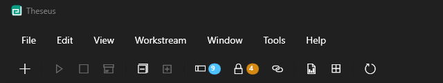

# Theseus help

Theseus is a Windows board for running many Claude Code sessions at once. Each piece of work is a
**workstream**, shown as a card. Starting a card opens a Windows Terminal tab running Claude Code in
that workstream's folder. Stopping it asks the session to write its handover notes first, so the next
session can carry on where it left off.

## Contents

- [The board](board.md): columns and rows, folding, the Paused and Blocked marks, and the menus,
  toolbar and status bar.
- [Cards](cards.md): what each button on a card does, and what a card is telling you.
- [Starting and stopping](starting-and-stopping.md): how a session starts and stops, and what to look
  at when one of them does nothing.
- [Chains and proposals](chains.md): workstreams that hand over to each other, and sessions that
  propose new ones.
- [Locks](locks.md): the machine's shared locks for test runs, the docker stack and the local model
  server.
- [Updates](updates.md): how Theseus finds and installs a newer version.
- [Keyboard shortcuts](shortcuts.md).

Press **F1** in Theseus, or choose **Help > View help**, to open these pages.

The source is at https://github.com/nigelbasel/Theseus under the MIT licence.
